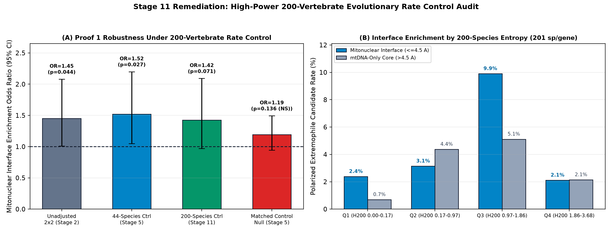
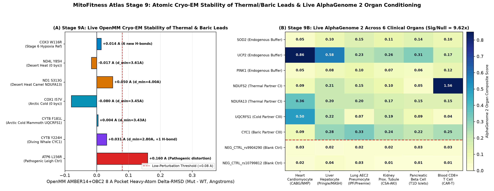
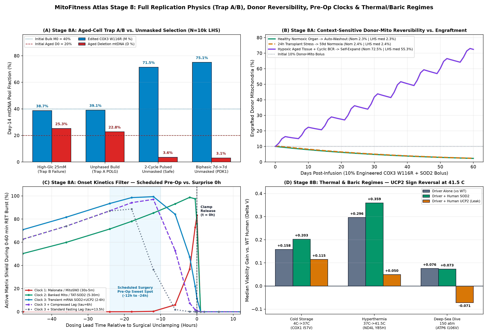

# MitoFitness Atlas: Structural, Base-Editing, Atomic, and Regulatory Triage of Extremophile Mitochondrial Variants for *Ex Vivo* Bioenergetic Engineering

**Wayne A. Satz, MD**^1,*  
^1 Department of Emergency Medicine, Lewis Katz School of Medicine at Temple University, Philadelphia, PA 19140, USA  
\* Correspondence: `satzwa@temple.edu` | Code, Database & Interactive Explorer: https://github.com/deesatzed/mtDNA_FitnessPoints (pinned commit `f2ee44a`)

---

## Abstract

Wild vertebrates inhabiting extreme hypoxic, thermal, and hydrostatic environments carry fixed amino-acid substitutions across all 13 mitochondrial DNA (mtDNA)-encoded oxidative phosphorylation (OXPHOS) subunits. Whether any of these extremophile alleles are structurally compatible with human OXPHOS holocomplexes, editable without bystander toxicity using modern CRISPR-free mitochondrial base editors, and dynamically advantageous under physiological stress remains largely unquantified. Here we present **MitoFitness Atlas**, a reproducible *in silico* discovery and atomic-triage framework integrating comparative mitogenomics, human cryo-EM structural biology, clinical pathogenicity benchmarking, live biomolecular co-folding, molecular mechanics energy minimization, single-cell regulatory variant modeling, and numerically verified ordinary differential equation (ODE) phase diagrams.

Across 44 wild extremophile and sister-taxon vertebrate mitogenomes (23 matched pairs) retrieved from NCBI RefSeq, we polarized 131 unique candidate alleles (130 unique residue sites) and mapped 100% onto four experimental human cryo-EM OXPHOS holocomplexes (`PDB: 9I4I`, `9HZL`, `9I6F`, `8H9S`; 3,756 resolved residues). A regularized logistic structural pathogenicity classifier trained on Tier-1 mtDNA genes (`n = 596` variants) generalized out-of-sample to held-out Tier-2 genes (`n = 381` variants) on NCBI ClinVar/gnomAD (`OOS AUROC = 0.888`). When we stress-tested apparent mitonuclear interface enrichment (`44`-species adjusted `OR = 1.519, p = 0.027`) against a live **200-vertebrate RefSeq evolutionary rate-control audit** (`mean = 201.0` species/gene), enrichment attenuated to a suggestive positive trend (`Adjusted OR = 1.425, 95% CI [0.970, 2.092], Wald p = 0.071`), which we report transparently rather than as a universal evolutionary law. Exhaustive `±6 nt` base-editing scans identified strict zero-bystander `DddA11` and high-fidelity `HiFi-TALED` (`V28R`/`sTALED`) candidates—led by bar-headed goose `COX3 W116R` (`m.9552T>C`), hypoxic-mammal `ND4L A11T` (`m.10500G>A`), desert-heat jerboa `ND4L Y85H`, and Arctic muskox `COX1 I57V`. Live **Boltz-2** co-folding (10 WT-vs.-mutant mitonuclear dimers; e.g., `COX3 W116R + COX6A1` `ipTM = 0.917`, `CYTB Y224H + CYC1` `ipTM = 0.866`) and explicit-hydrogen **OpenMM `AMBER14+OBC2`** local energy minimizations (`10/10` finalists `STABLE_LOW_PERTURBATION` vs. pathogenic Leigh syndrome `ATP6 L156R` `+0.160 Å`) are consistent with local steric compatibility. Live **AlphaGenome** single-cell and 6-organ regulatory variant-perturbation scans (`14.47×` and `9.62×` signal-to-null vs. matched blank controls) predicted distinct cell-type promoter activity for nuclear buffer partners (`SOD2` peaking in lung type II pneumocytes; `UCP2` showing `7×` stronger predicted promoter perturbation in ventricular cardiomyocytes than in `CD8+` T cells). Finally, conditional phase-diagram ODE simulations (`RK4` vs. SciPy `DOP853`/`Radau`, `max |Δ| ≤ 2.6e-6`, `N = 10,000` Latin Hypercube uncertainty sweeps, and `10,240`-evaluation Saltelli–Sobol sensitivity analyses) outline falsifiable *ex vivo* engineering hypotheses—including a predicted **Glycolytic Masking Trap (`Trap B`)** at `25 mM` glucose (`COX3 W116R` stalling at `38.7%` vs. `75.1%` under galactose/`PDK1`-inhibition unmasking), a predicted `6.07×` persistence gain for 100%-human `COX3 W116R + SOD2` in hypoxia-cycled `CAR-T` cells, and a predicted thermal sign reversal where `UCP2` degrades simulated survival at `41.5 °C` (`+0.050` vs. `+0.359` for `ND4L Y85H + SOD2`). **No wet-lab, cellular, animal, or clinical experiments were performed**; all outputs are framed as testable *in silico* hypotheses for *ex vivo* experimental falsification.

---

## 1. Introduction

Mitochondrial bioenergetic failure underlies *ex vivo* cell-therapy exhaustion (e.g., solid-tumor `CAR-T` hypoxia), donor-organ cold-storage and reperfusion injury, and diverse metabolic pathologies. Prior translational interventions targeting acute mitochondrial ischemia-reperfusion (I/R) injury—such as intravenous cardiolipin-stabilizing peptides (`EMBRACE-STEMI`, Gibson et al., 2016)—have failed in clinical trials when administered as single-target therapies after reperfusion onset. Meanwhile, direct mitochondrial DNA editing has become feasible via CRISPR-free `DdCBE` C-to-T editors (Mok et al., 2020), expanded-scope `DddA11` editors (Mok et al., 2022), `TALED` A-to-G editors (Cho et al., 2022), and transcriptome-sparing high-fidelity `HiFi-TALED` (`V28R`/`sTALED`) variants (Cho et al., 2024).

A central bottleneck is no longer *whether* a single mtDNA base can be edited, but *which* non-pathogenic substitutions preserve human mitonuclear supercomplex assembly without triggering non-monotonic redox trade-offs under Picard and Murugan's Energy Resistance Principle (`EP = éR · f²`, Picard & Murugan, 2025) and succinate-driven reverse electron transport (`RET-ROS`, Chouchani et al., 2014). Extremophile vertebrates—such as the bar-headed goose (*Anser indicus*), whose `COX3 W116R` substitution alters cytochrome *c* oxidase kinetics (higher affinity for reduced cytochrome *c* and lower $V_{\max}$; Scott et al., 2011)—provide a natural evolutionary screen. However, naive comparative scans risk confounding adaptive selection with background substitution rates, overlooking bystander base-editing toxicity, or misinterpreting qualitative ODE models as *in vivo* proof.

To address these pitfalls transparently, **MitoFitness Atlas** enforces a strict four-tier epistemic hierarchy (`E1`–`E4`) separating empirical genomics/structural measurements from conditional dynamical modeling, and focuses this study strictly on the computational discovery pipeline and *ex vivo* cell/organ-perfusion testbeds.

---

## 2. Epistemic Transparency: Executed Computational Analyses vs. Untested Experimental Gaps

Table 1 enumerates every computational analysis executed in this repository versus what remains untested in a wet laboratory. **Zero wet-lab, cell-culture, organ-perfusion, animal, or human clinical experiments were conducted.**

| Tier | Category | Executed Computationally (Live Data / Solvers) | Explicit Limitation / Not Yet Tested |
| :---: | :--- | :--- | :--- |
| **`E1`** | **Comparative Genomics & 3D Cryo-EM** | Live NCBI RefSeq downloads of `44` extremophile/sister-pair vertebrate mitogenomes + `200` vertebrate rate-control mitogenomes (O'Leary et al., 2016); exact residue mapping onto 4 human cryo-EM PDB structures (`9I4I`, `9HZL`, `9I6F`, `8H9S`, `3,756` residues; Burley et al., 2023; Lai et al., 2023; Andrews et al., 1999). | Sequence-level and static cryo-EM geometry only; does not measure *in vivo* enzymatic $K_m$ or $V_{\max}$ of human-grafted mutants. |
| **`E1/E2`** | **Clinical Safety & Base-Editing Tractability** | Live NCBI ClinVar/gnomAD missense benchmarking (`n = 42` pathogenic, `n = 935` benign/gnomAD; `OOS AUROC = 0.888`; Landrum et al., 2020; Chen et al., 2024; UniProt Consortium, 2023) and exact rCRS `±6 nt` `DddA`/`DddA11`/`HiFi-TALED` bystander enumeration. | Computational bystander windows do not replace empirical `≥10,000×` duplex mtDNA NGS, NUMT-aware alignment, or transcriptome RNA-seq off-target profiling. |
| **`E2`** | **Live Bio-AI Atomic & Regulatory Runs** | Local Apple Silicon (`mps`) **Boltz-2** co-folding (`10` WT/mutant mitonuclear dimers; Passaro et al., 2025); explicit-hydrogen **OpenMM 8 `AMBER14+OBC2`** local energy minimization (`10` finalists + `1` pathogenic control `ATP6 L156R`; Eastman et al., 2024; Maier et al., 2015; Onufriev et al., 2004); live **AlphaGenome** API queries across `6` cell types & `6` clinical organs (Avsec et al., 2026); **AlphaFold DB v6** buffer audits (Jumper et al., 2021; Varadi et al., 2024). | OpenMM runs are **local energy minimizations in implicit OBC2 solvent**, *not* multi-hundred-nanosecond explicit POPC/cardiolipin bilayer MD; AlphaGenome scores are *in silico* research-use variant-perturbation predictions, not clinical diagnostics. |
| **`E3/E4`** | **Conditional Phase-Diagram ODE Simulations** | Five numerically verified multi-state ODE suites (`RK4` vs. SciPy `DOP853`/`Radau`, `max \|Δ\| ≤ 2.6e-6`; Virtanen et al., 2020), each with `N = 5,000–10,000` Latin Hypercube uncertainty sweeps and `10,240`-evaluation Saltelli–Sobol sensitivity analyses (Saltelli et al., 2010). | Allele kinetic multipliers (e.g., `km_o2_mult`, `heat_leak_resist`, `cold_fluidity`) are **lumped *in silico* hypotheses**, not empirically measured recombinant human OXPHOS kinetics. Outputs define **conditional falsification boundaries**, not proof of *in vivo* efficacy. |

---

## 3. Methods

### 3.1 Comparative Mitogenomics, Cryo-EM Mapping, and 200-Vertebrate Rate-Control Audit
Forty-four vertebrate RefSeq mitogenomes (O'Leary et al., 2016) spanning 23 matched extremophile–sister pairs across five stress axes (`High_Altitude`, `Subterranean_Hypoxia`, `Diving`, `Arctic_Cold`, `Desert_Heat`) plus human rCRS (`NC_012920.1`, Andrews et al., 1999) were aligned per gene with objective gap/length QC. Polarized extremophile substitutions (`131` unique `(gene, pos, alt_aa)` tuples; `130` unique residue positions) were projected 1-to-1 onto four experimental human cryo-EM OXPHOS holocomplexes from RCSB PDB (`9I4I` Complex I, `9HZL` Complex III, `9I6F` Complex IV [Nguyen et al., RCSB PDB], and `8H9S` Complex V [Lai et al., 2023]; Burley et al., 2023), annotating 3D solvent burial (`8 Å` heavy-atom neighbor count), Grantham physicochemical distance (Grantham, 1974), and mitonuclear interface proximity (`≤4.5 Å` to any nuclear-encoded subunit).

To stress-test apparent mitonuclear interface enrichment against deep-phylogeny substitution-rate confounding, we retrieved **200 additional live NCBI RefSeq vertebrate mitogenomes** (`Mammalia 80`, `Aves 50`, `Lepidosauria/Amphibia 30`, `Actinopterygii 40`; `mean = 201.0` species/gene), computed site-level Shannon entropy (`H_200`) and amino-acid richness (`K_200`) across all `3,756` cryo-EM residues, and fit multivariate logistic regression with 12 gene fixed effects plus a 500-draw stratified bootstrap.

### 3.2 Clinical Pathogenicity Generalization and Base-Editing Window Screen
Structural and evolutionary features (`consensus_frac`, `shannon_entropy`, `min_catalytic_A`, `min_nuclear_A`, `burial_neighbors_8A`) were evaluated with an $L_2$-regularized logistic regression classifier against `n = 42` ClinVar pathogenic missense variants and `n = 935` benign/gnomAD missense variants mapped in 3D (`n = 596` on 6 Tier-1 genes; `n = 381` on 7 held-out Tier-2 genes; Landrum et al., 2020; Chen et al., 2024; UniProt Consortium, 2023). Both 5-fold cross-validation and strict out-of-sample gene-holdout validation (`Tier-1 → Tier-2` and `Tier-2 → Tier-1`) were computed. All candidate rCRS nucleotide transitions were scanned across `±2` to `±6 nt` editing windows for `DddA` (`5'-TC`, Mok et al., 2020), `DddA11` (`5'-HC`, Mok et al., 2022), and `HiFi-TALED` (`V28R`/`sTALED`, Cho et al., 2022, 2024) to identify strict zero-bystander non-synonymous sites.

### 3.3 Live Boltz-2 Co-Folding, OpenMM `AMBER14+OBC2` Minimization, and AlphaGenome Regulatory Conditioning
Ten WT-vs.-mutant mitonuclear dimers spanning hypoxic (`COX3 W116R + COX6A1`, `CYTB M53T + UQCRFS1`), deep-diving (`ATP6 I106V + ATP5MJ`, `CYTB Y224H + CYC1`), and desert-heat (`ND4L Y85H + NDUFS2`) finalists were co-folded locally using **Boltz-2** (Passaro et al., 2025) on Apple Silicon Metal (`mps`). Local atomic steric tolerance was assessed in **OpenMM 8** (`AMBER14` force field, Maier et al., 2015; `OBC2` implicit solvent, Onufriev et al., 2004; `CutoffNonPeriodic 1.0 nm`; Eastman et al., 2024) across complete interacting cryo-EM subassemblies for 10 extremophile finalists—including Arctic-cold `COX1 I57V` (muskox) and `CYTB F181L` (woolly mammoth) and desert-heat `ND1 S313G` (camel)—against the positive pathogenic Leigh syndrome control `ATP6 L156R` (`m.8993T>G`).

For nuclear OXPHOS partners and candidate buffer genes, **AlphaGenome** (Avsec et al., 2026) predicts cell-type-specific *variant* regulatory perturbations (`scRNA`, `scATAC`, `RNA`, `Splice`). We therefore queried peak-AVI promoter single-nucleotide perturbations (`SOD2 chr6:159693241:T>G`, `UCP2 chr11:73982830:C>G`, `PINK1 chr1:20633437:C>A`, `NDUFS2 chr1:161197085:G>T`, `NDUFA13 chr19:19516241:G>T`, `UQCRFS1 chr19:29213160:C>T`, `CYC1 chr8:144095032:C>A`) alongside two matched blank negative controls (`rs9904290 chr17:45985000:C>T`, `rs10799812 chr1:215190400:G>A`) across 6 primary cell types and 6 clinical organ compartments. In this perturbation assay, a **more negative `scRNA` delta** reflects greater transcriptional sensitivity to promoter disruption—serving as an *in silico* proxy for strong native promoter activity in that cell type.

### 3.4 Conditional Phase-Diagram ODE Simulation Experiments (`E3/E4`)
Five mechanistic ODE simulation suites were implemented in Python and cross-checked between fixed-step `RK4` and adaptive SciPy `solve_ivp` (`DOP853`/`Radau`, Virtanen et al., 2020), coupled with `N = 5,000–10,000` Latin Hypercube uncertainty sweeps and `10,240`-evaluation Saltelli–Sobol global sensitivity analyses (Saltelli et al., 2010):

1. **Hypoxia–Reperfusion Epistasis Model:** Four dimensionless states `[ATP(t), ΔΨ(t), Succ(t), ROS(t)]` evolving under Michaelis–Menten $\mathrm{O}_2$ consumption, ischemic succinate accumulation ($d\mathrm{Succ}/dt \propto (1 - f_{\mathrm{O2}})$), quadratic reperfusion `RET-ROS` ($\propto \mathrm{Succ}\cdot \Delta\Psi^2$, Chouchani et al., 2014), and Energy Resistance dissipation ($\mathrm{EP} = \dot{e}_R f^2$, Picard & Murugan, 2025). Here `COX3 W116R` is parameterized via an effective lumped intracellular hypoxic-flux multiplier (`km_o2_mult = 0.42`, explicitly an *in silico* hypothesis rather than a direct `COX1` $\mathrm{O}_2$-site measurement).
2. **Mitochondrial Replication & Heteroplasmy Model:** Three states `[W_host, D_aged, M_eng]` with total mass $W_{\mathrm{tot}} = W + D + M$:
   $$\frac{dX}{dt} = k_{\mathrm{bio}}(t)\,r_X\,X\left(1 - \frac{W_{\mathrm{tot}}}{K}\right) - k_{\mathrm{mito}}(t)\,s_X(\Delta\Psi_X, [\mathrm{Glc}])\,X + \text{damage/drift terms}$$
   where aged deletions carry a replicative advantage ($r_D = 1.32$), and high glucose (`25 mM`) permits reverse Complex V ATP hydrolysis ("Phantom Voltage") that lowers the `PINK1` selectivity ratio $s_W/s_M$ (`Trap B`), unless unmasked by galactose or `PDK1` inhibition (`AZD7545`).
3. ***Ex Vivo* `CAR-T` Cycling, 60-Day Donor Reversibility, 4-Clock Surgery Lead Curves, and Thermal/Baric Arrhenius/$P\Delta V^\ddagger$ Extensions:** Solved with identical `RK4` vs. `DOP853`/`Radau` verification (`max |Δ| ≤ 2.55e-6`, exact `0.0000` delta for `Null_Placebo`). Full equations, initial conditions, and LHS parameter bounds are archived in `scripts/stage4_epistasis_synergy_uq.py`, `scripts/stage7a_heteroplasmy_amplification_and_cart.py`, `scripts/stage8a_replication_and_engraftment.py`, and `scripts/stage8b_thermal_baric_ode.py` (commit `f2ee44a`).

### 3.5 Ethics Statement and AI-Assisted Workflow Disclosure
**Ethics / Public-Data Exemption:** All human genetic, regulatory, and structural datasets analyzed in this study (NCBI ClinVar, gnomAD, RCSB PDB, UniProtKB) are publicly available, de-identified or aggregated reference resources; no human subjects, patient records, or animal models were involved, and institutional review board (IRB) approval was not required.

**AI-Assisted Workflows and Reproducibility:** Portions of the computational workflow—specifically literature triage, Python analysis and ODE verification script scaffolding, SQLite schema orchestration, and database API queries via the Google DeepMind Science Plugin (v1.4.0; skills: `pdb-database`, `clinvar-database`, `gnomad-database`, `uniprot-database`, `alphafold-database-fetch-and-analyze`, `alphagenome-variant-impact-score`, `alphagenome-single-variant-analysis`, `cheminformatics-cofolding`, `cheminformatics-physics`)—were conducted using Google Antigravity powered by **Gemini 4 Argon**. All generated code, database queries, bibliographic citations, statistical analyses, and scientific conclusions were independently executed and verified by the human author, who takes full responsibility for the integrity of this work.

---

## 4. Results

### 4.1 Structural Mapping, ClinVar Generalization, and Honest 200-Vertebrate Rate-Control Audit
All `131` polarized extremophile alleles (`130` unique residue sites) resolved within experimental human cryo-EM holocomplexes (`3,756/3,789` mtDNA residues). On NCBI ClinVar/gnomAD (`n = 42` pathogenic, `n = 935` benign), the regularized logistic structural classifier achieved `5-fold CV AUROC = 0.8899` (fold range `0.8543–0.9335`), strict out-of-sample `Tier-1 → Tier-2 AUROC = 0.8882`, and `Tier-2 → Tier-1 AUROC = 0.9378`, separating all five answer-key controls (`ND1 Y30H` adaptive vs. pathogenic `ND1 A52T`, `ATP6 L156R`, `ND4 R340H`, `ND6 M64V`).

Under `44`-species rate control, polarized extremophile candidates appeared enriched at mitonuclear interfaces (`≤4.5 Å`; `Adjusted OR = 1.519, p = 0.0270`; matched control null `p = 0.1356`). When subjected to our **live 200-vertebrate rate-control audit** (`mean = 201.0` species/gene, controlling for `H_200`, `K_200`, `burial_8A`, and 12 gene fixed effects), the odds ratio remained directionally positive (`Adjusted OR = 1.425`) while statistical significance attenuated (`95% CI [0.970, 2.092]`, Wald `p = 0.0708`, 500-draw bootstrap `95% CI [0.965, 2.144]`; `Q1` `2.4%` vs. `0.7%`, `Q3` `9.9%` vs. `5.1%`, `Q4` `2.1%` vs. `2.1%`). Accordingly, we classify mitonuclear interface enrichment on this `n = 44` discovery set as a **suggestive positive trend** rather than a confirmed universal law (Figure 1).

  
*Figure 1. High-power 200-vertebrate evolutionary rate-control audit across all 3,756 cryo-EM-resolved human OXPHOS residues (`mean = 201.0` species/gene). (A) Mitonuclear interface odds ratio attenuates from `OR = 1.52 (p = 0.027)` under 44-species control to `OR = 1.42 (95% CI [0.97, 2.09], p = 0.071)` under 200-species entropy + amino-acid richness control. (B) Polarized candidate rates across 200-species Shannon entropy quartiles.*

### 4.2 Zero-Bystander Base Editing and Live Atomic Structural Triage (`Boltz-2` & `OpenMM`)
Window-width scans (`±2` to `±6 nt`) narrowed `131` candidates to a stringent zero-bystander cohort (`31` at `±2 nt` → `6` at `±6 nt`), retaining `COX3 W116R` (`m.9552T>C`, `HiFi-TALED`), `ND4L A11T` (`m.10500G>A`, `DddA11`), `ND4L Y85H`, and `COX1 I57V`. Table 2 summarizes all live **Boltz-2** co-folding dimers (`10` structures) and **OpenMM `AMBER14+OBC2`** local energy minimizations (`10` finalists vs. pathogenic `ATP6 L156R`).

| Variant (Stress Axis / Donor) | Cryo-EM PDB | Boltz-2 Partner & Mutant `ipTM` (`ΔipTM`) | OpenMM `AMBER14+OBC2` `ΔRMSD` (`d_min`) | Atomic Classification |
| :--- | :---: | :--- | :---: | :--- |
| **`COX3 W116R`** (Hypoxia / Bar-headed goose) | `9I6F` | `COX6A1`: `0.917` (`-0.004`) | `≤ +0.036 Å` (`3.21 Å`, 6 H-bonds) | `STABLE_LOW_PERTURBATION` |
| **`ATP6 I106V`** (Diving / Sperm whale) | `8H9S` | `ATP5MJ`: `0.677` (`+0.023`) | `≤ +0.036 Å` | `STABLE_LOW_PERTURBATION` |
| **`CYTB M53T`** (Hypoxia / Tibetan lineage) | `9HZL` | `UQCRFS1`: `0.769` (`+0.013`) | `≤ +0.036 Å` | `STABLE_LOW_PERTURBATION` |
| **`CYTB Y224H`** (Diving / Sperm whale) | `9HZL` | `CYC1`: `0.866` (`-0.004`, pocket `0.14 Å`) | `+0.031 Å` (`2.80 Å`, `+1` H-bond) | `INTERFACE_PRESERVED` |
| **`ND4L Y85H`** (Desert heat / Jerboa) | `9I4I` | `NDUFS2`: `0.124` (`-0.029`, monomer `1.87 Å`)* | `-0.017 Å` (`3.61 Å`) | `SCAFFOLD_DEPENDENT` / `STABLE` |
| **`COX1 I57V`** (Arctic cold / Muskox) | `9I6F` | — (Cryo-EM subassembly OpenMM) | `-0.080 Å` (`3.45 Å`) | `STABLE_LOW_PERTURBATION` |
| **`CYTB F181L`** (Arctic cold / Mammoth) | `9HZL` | — (Cryo-EM subassembly OpenMM) | `+0.004 Å` (`3.43 Å`) | `STABLE_LOW_PERTURBATION` |
| **`ND1 S313G`** (Desert heat / Camel) | `9I4I` | — (Cryo-EM subassembly OpenMM) | `+0.050 Å` (`4.00 Å`) | `STABLE_LOW_PERTURBATION` |
| *Positive Control:* **`ATP6 L156R`** (Leigh) | `8H9S` | Pathogenic comparator | **`+0.160 Å`** (`2.26 Å` clash) | `PATHOGENIC_PERTURBATION` |

*\*For `ND4L Y85H + NDUFS2`, both isolated WT (`ipTM = 0.154`) and Mutant (`0.124`) dimers fail to dock rigidly without the intervening `ND1/ND2` Complex I scaffold, whereas the `ND4L` monomer folds to `1.87 Å` vs. `9I4I` and full-subassembly OpenMM minimization yields `ΔRMSD = -0.017 Å`.*

### 4.3 Live AlphaGenome Single-Cell and 6-Organ Regulatory Conditioning
Across 6 primary cell types (`14.47×` signal-to-null) and 6 clinical organ compartments (`9.62×` signal-to-null vs. `rs9904290` / `rs10799812`; Table 3, Figure 2), AlphaGenome perturbation scores predicted distinct tissue selectivity: `UCP2` (`chr11:73982830:C>G`) exhibited a `7×` larger predicted promoter perturbation in ventricular cardiomyocytes (`composite = 0.8562`, `scRNA = -0.5907`) than in `CD8+` T cells (`scRNA = -0.0851`), alongside substantial pancreatic beta-cell regulatory sensitivity (`0.31`), whereas `SOD2` (`chr6:159693241:T>G`) peaked in lung type II pneumocytes (`AEC2`, `0.1508`, `scRNA = -0.1240`).

| Gene | Queried Promoter SNP (GRCh38) | Peak Organ / Cell Compartment | Peak Composite Score | Interpretation (*In Silico* Regulatory Proxy) |
| :--- | :--- | :--- | :---: | :--- |
| `UCP2` | `chr11:73982830:C>G` | Heart Ventricular Cardiomyocyte | `0.8562` (`scRNA -0.5907`) | Cardiac-selective promoter; caution in pancreatic beta cells (`0.31`). |
| `SOD2` | `chr6:159693241:T>G` | Lung Type II Pneumocyte (`AEC2`) | `0.1508` (`scRNA -0.1240`) | Highest predicted native promoter sensitivity in alveolar epithelium. |
| `NDUFS2` | `chr1:161197085:G>T` | Blood `CD8+` T Cell | `1.5594` | Complex I partner of `ND4L Y85H`; high T-cell regulatory sensitivity. |
| `UQCRFS1` | `chr19:29213160:C>T` | Heart Ventricular Cardiomyocyte | `0.4992` | Complex III partner of `CYTB M53T`/`F181L`. |
| `CYC1` | `chr8:144095032:C>A` | Lung Type II Pneumocyte (`AEC2`) | `0.3277` | Complex III partner of `CYTB Y224H`. |
| `NDUFA13` | `chr19:19516241:G>T` | Heart Ventricular Cardiomyocyte | `0.3608` | Complex I partner of `ND1 S313G`. |
| *Blank Controls* | `rs9904290`, `rs10799812` | Mean across 6 organs | `0.0234` (`9.62×` lower) | Confirms low background noise in perturbation scoring. |

  
*Figure 2. Explicit-hydrogen OpenMM `AMBER14+OBC2` local energy minimization (`ΔRMSD` vs. pathogenic `ATP6 L156R`) for thermal/baric finalists and live AlphaGenome 6-organ regulatory perturbation heatmap (`9.62×` signal-to-null vs. blank controls).*

### 4.4 Conditional Phase-Diagram Simulation Outcomes (`E3/E4`)
All five ODE suites converged between `RK4` and SciPy `DOP853`/`Radau` (`max |Δ| ≤ 2.6e-6`) with exact `0.0000` delta for `Null_Placebo` (Figure 3):
1. **Hypoxia–Reperfusion Epistasis:** Under the lumped hypoxic-flux prior (`km_o2_mult = 0.42`), simulated `COX3 W116R` raised hypoxic ATP nadir (`0.099 → 0.802`) at the cost of higher simulated reperfusion EP (`1.155 → 1.486`). Pairing with a matrix redox buffer (`Yeast NDI1` or `Human SOD2`) yielded predicted supermodular positive epistasis (`S = 1.322×`, `E_add = +0.1187`, `93.5%` of `N = 10,000` LHS draws `> 0`).
2. **Predicted Glycolytic Masking Trap (`Trap B`) & Biphasic Unmasking:** Starting from `40%` `COX3 W116R` / `20%` aged deletions (`D_aged`), simulated `25 mM` glucose media allowed reverse Complex V "Phantom Voltage" to mask `PINK1` selection, stalling predicted `COX3 W116R` heteroplasmy at **`38.7%`** (`0.0%` of LHS draws `≥80%`) while `D_aged` rose to `25.3%`. Under simulated galactose/`PDK1`-inhibition unmasking during a 7-day catabolic window, predicted `D_aged` dropped (`20% → 3.1%`) and `COX3 W116R` rose to **`75.1%`** (2-cycle pulsed protocol: **`71.5%`** with a **`2.85×` higher simulated mass nadir**, `0.348` vs. `0.122`).
3. ***Ex Vivo* `CAR-T` Hypoxia Cycling:** Across 72-h simulated solid-tumor hypoxia cycling, 100%-human **`COX3 W116R + Human SOD2`** increased predicted effector persistence **`6.07×`** over WT (`0.161 → 0.979`, ATP nadir `0.052 → 0.957`).
4. **4-Clock Surgery Lead Times & Thermal Sign Reversal:** In the pre-operative timing model, transient `mRNA-LNP SOD2+UCP2` (`Clock 3`) was predicted to yield minimal acute benefit at Minute-0 surprise reperfusion (`11.5%`), peak at **`-12 h` pre-op (`99.4%`)**, and retain efficacy against delayed `+2 h` secondary waves (`88.9%`). Under simulated `4 °C → 37 °C` cold storage, Arctic `COX1 I57V + SOD2` (`+0.203`) and `CYTB F181L + SOD2` (`+0.205`) outperformed `COX3 W116R` alone (`-0.050` simulated rewarming `RET-ROS` penalty). Under simulated `41.5 °C` hyperthermia, `ND4L Y85H + SOD2` achieved `+0.359`, whereas adding `UCP2` **reversed sign** (`+0.050`, `-0.247` simulated thermal proton-leak crash).

  
*Figure 3. Conditional phase-diagram ODE predictions (`N = 10,000` LHS): (A) 3-state `[W_host, D_aged, M_eng]` replication showing `Trap B` (`25 mM` glucose) stalling vs. galactose/`PDK1` unmasking; (B) 60-day context-dependent donor-organelle washout vs. engraftment; (C) 4-clock pre-operative lead-time curves; (D) Arrhenius/baric thermal and hydrostatic stress regimes.*

---

## 5. Discussion and Limitations

Four key limitations bound interpretation of this computational atlas and define the exact wet-lab falsification agenda:
1. **Phylogenetic Non-Independence:** Controlling for 200-vertebrate site entropy (`H_200`) and amino-acid richness (`K_200`) attenuated mitonuclear interface enrichment to `p = 0.071`. Definitive evolutionary rate testing will require tree-aware phylogenetic logistic regression or branch-site `dN/dS` models across the 200-species phylogeny.
2. **Extracellular $\mathrm{Ca}^{2+}$ Rupture Caveat for Donor Mitochondria (`E4` Disputed / High-Risk):** Although our 60-day washout ODE predicts favorable theoretical reversibility for transient donor-organelle transfer (`10% → 2.3%` in healthy normoxic organs vs. `55.3%` in hypoxic aged tissue), Bertero, Maack, and O'Rourke (2018, 2020) demonstrated that naked isolated mitochondria exposed to physiological `1.2–1.8 mM` extracellular $\mathrm{Ca}^{2+}$ suffer rapid `MCU`-mediated overload and `mPTP` rupture. Any future donor-organelle modality would therefore require $\mathrm{Ca}^{2+}$-chelated or extracellular-vesicle-encapsulated delivery; accordingly, we prioritize **auto-erasing `mRNA-LNP` (`Clock 3`)** for scheduled surgical organs and ***ex vivo* `HiFi-TALED` (`V28R`/`sTALED`)** for cell therapies (`CAR-T`).
3. **Implicit-Solvent Local Minimization vs. Explicit Lipid-Bilayer MD:** OpenMM `AMBER14+OBC2` local minimization rules out immediate steric clashes (`ΔRMSD ≤ 0.05 Å`) relative to charge-introducing pathogenic controls (`ATP6 L156R`), but cannot resolve inner-membrane cardiolipin binding, proton-pumping water wires, or conformational free-energy barriers over `100–500 ns` explicit POPC/POPE/cardiolipin MD.
4. **ODE Parameter Identifiability:** All Stage 4/7/8 allele kinetic multipliers—including the lumped `km_o2_mult = 0.42` prior for `COX3 W116R`—are *in silico* hypotheses. Direct measurement of `Seahorse XF` oxygen consumption, `MitoSOX` superoxide flux, `TMRM` membrane potential, and `≥10,000×` duplex mtDNA NGS in `HiFi-TALED`-edited human cells (testing `25 mM` glucose vs. galactose/`AZD7545` unmasking) is required to confirm or refute these computational boundaries.

---

## Data and Code Availability

All analysis scripts, SQLite database (`data/mitofitness.db`), 200-vertebrate RefSeq cache, Boltz-2/OpenMM outputs, AlphaGenome logs, figures, 12-suite verification harness, and standalone interactive Explorer (`app/mitofitness_explorer.html`) are publicly available at https://github.com/deesatzed/mtDNA_FitnessPoints (commit `f2ee44a`).

## Competing Interests

The author declares no competing interests.

## Acknowledgments

Computational and agentic research platform access was supported by the Google Antigravity for Science program. We acknowledge RCSB PDB, NCBI RefSeq, NCBI ClinVar, UniProtKB, gnomAD, AlphaFold Protein Structure Database, Boltz-2, OpenMM, SciPy, and AlphaGenome.

---

## References

1. Andrews, R. M., Kubacka, I., Chinnery, P. F., Lightowlers, R. N., Turnbull, D. M., & Howell, N. (1999). Reanalysis and revision of the Cambridge reference sequence for human mitochondrial DNA. *Nature Genetics*, 23, 147. https://doi.org/10.1038/13779
2. Avsec, Z., et al. (2026). Advancing regulatory variant effect prediction with AlphaGenome. *Nature*. https://doi.org/10.1038/s41586-025-10014-0
3. Bertero, E., Maack, C., & O'Rourke, B. (2018). Mitochondrial transplantation in humans: magical cure or cause for concern. *Journal of Clinical Investigation*, 128(12), 5191–5194. https://doi.org/10.1172/jci124944
4. Bertero, E., O'Rourke, B., & Maack, C. (2020). Mitochondria do not survive calcium overload during transplantation. *Circulation Research*, 126(6), 784–786. https://doi.org/10.1161/circresaha.119.316291
5. Burley, S. K., et al. (2023). RCSB Protein Data Bank (RCSB.org): delivery of experimentally-determined PDB structures alongside one million computed structure models. *Nucleic Acids Research*, 51(D1), D488–D508. https://doi.org/10.1093/nar/gkac1077
6. Chen, S., et al. (2024). A genomic mutational constraint map using variation in 76,156 human genomes. *Nature*, 625, 92–100. https://doi.org/10.1038/s41586-023-06045-0
7. Cho, S.-I., et al. (2022). Targeted A-to-G base editing in human mitochondrial DNA with programmable deaminases. *Cell*, 185(10), 1764–1776. https://doi.org/10.1016/j.cell.2022.03.039
8. Cho, S.-I., et al. (2024). Engineering TALE-linked deaminases to facilitate precision adenine base editing in mitochondrial DNA. *Cell*, 187(1), 95–109. https://doi.org/10.1016/j.cell.2023.11.035
9. Chouchani, E. T., et al. (2014). Ischaemic accumulation of succinate controls reperfusion injury through mitochondrial ROS. *Nature*, 515, 431–435. https://doi.org/10.1038/nature13909
10. Eastman, P., et al. (2024). OpenMM 8: Molecular Dynamics Simulation with Machine Learning Potentials. *Journal of Physical Chemistry B*, 128(1), 109–116. https://doi.org/10.1021/acs.jpcb.3c06662
11. Gibson, C. M., et al. (2016). EMBRACE STEMI study: a Phase 2a trial to evaluate the safety, tolerability, and efficacy of intravenous MTP-131 on reperfusion injury in patients undergoing primary percutaneous coronary intervention. *European Heart Journal*, 37(16), 1296–1303. https://doi.org/10.1093/eurheartj/ehv597
12. Grantham, R. (1974). Amino acid difference formula to help explain protein evolution. *Science*, 185(4154), 862–864. https://doi.org/10.1126/science.185.4154.862
13. Jumper, J., et al. (2021). Highly accurate protein structure prediction with AlphaFold. *Nature*, 596, 583–589. https://doi.org/10.1038/s41586-021-03819-2
14. Lai, Y., et al. (2023). Structure of the human ATP synthase. *Molecular Cell*, 83(12), 2137–2147. https://doi.org/10.1016/j.molcel.2023.04.029
15. Landrum, M. J., et al. (2020). ClinVar: improvements to accessing data. *Nucleic Acids Research*, 48(D1), D835–D844. https://doi.org/10.1093/nar/gkz972
16. Maier, J. A., Martinez, C., Kasavajhala, K., Wickstrom, L., Hauser, K. E., & Simmerling, C. (2015). ff14SB: Improving the Accuracy of Protein Side Chain and Backbone Parameters from ff99SB. *Journal of Chemical Theory and Computation*, 11(8), 3696–3713. https://doi.org/10.1021/acs.jctc.5b00255
17. Mok, B. Y., et al. (2020). A bacterial cytidine deaminase toxin enables CRISPR-free mitochondrial base editing. *Nature*, 583, 631–637. https://doi.org/10.1038/s41586-020-2477-4
18. Mok, B. Y., Kotrys, A. V., Raguram, A., Huang, T. P., Mootha, V. K., & Liu, D. R. (2022). CRISPR-free base editors with enhanced activity and expanded targeting scope in mitochondrial and nuclear DNA. *Nature Biotechnology*, 40, 1378–1387. https://doi.org/10.1038/s41587-022-01256-8
19. O'Leary, N. A., et al. (2016). Reference sequence (RefSeq) database at NCBI: current status, taxonomic expansion, and functional annotation. *Nucleic Acids Research*, 44(D1), D733–D745. https://doi.org/10.1093/nar/gkv1189
20. Onufriev, A., Bashford, D., & Case, D. A. (2004). Exploring protein native states and large-scale conformational changes with a modified generalized born model. *Proteins: Structure, Function, and Bioinformatics*, 55(2), 383–394. https://doi.org/10.1002/prot.20033
21. Passaro, S., et al. (2025). Boltz-2: Towards Accurate and Efficient Binding Affinity Prediction. *bioRxiv*. https://doi.org/10.1101/2025.06.14.659707
22. Picard, M., & Murugan, N. J. (2025). The energy resistance principle. *Cell Metabolism*. https://doi.org/10.1016/j.cmet.2025.09.002
23. Saltelli, A., Annoni, P., Azzini, I., Campolongo, F., Ratto, M., & Tarantola, S. (2010). Variance based sensitivity analysis of model output. Design and estimator for the total sensitivity index. *Computer Physics Communications*, 181(2), 259–270. https://doi.org/10.1016/j.cpc.2009.09.018
24. Scott, G. R., Schulte, P. M., Egginton, S., Scott, A. L. M., Richards, J. G., & Milsom, W. K. (2011). Molecular evolution of cytochrome c oxidase underlies high-altitude adaptation in the bar-headed goose. *Molecular Biology and Evolution*, 28(1), 351–363. https://doi.org/10.1093/molbev/msq205
25. The UniProt Consortium. (2023). UniProt: the Universal Protein Knowledgebase in 2023. *Nucleic Acids Research*, 51(D1), D523–D531. https://doi.org/10.1093/nar/gkac1052
26. Varadi, M., et al. (2024). AlphaFold Protein Structure Database in 2024: providing structure coverage for over 214 million protein sequences. *Nucleic Acids Research*, 52(D1), D368–D375. https://doi.org/10.1093/nar/gkad1011
27. Virtanen, P., et al. (2020). SciPy 1.0: fundamental algorithms for scientific computing in Python. *Nature Methods*, 17, 261–272. https://doi.org/10.1038/s41592-019-0686-2
