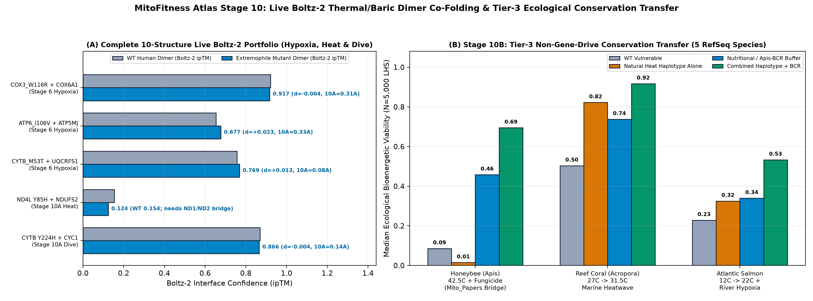

# Cross-Phylum Conservation of the Complex III $Q_o$ Strobilurin Pocket and Non-Gene-Drive Bioenergetic Epistasis in Pollinators, Reef Corals, and Cold-Water Salmonids

**Wayne A. Satz, MD**^1,*  
^1 Department of Emergency Medicine, Lewis Katz School of Medicine at Temple University, Philadelphia, PA 19140, USA  
\* Correspondence: `satzwa@temple.edu` | Code & Reproducibility: https://github.com/deesatzed/mtDNA_FitnessPoints (pinned commit `f2ee44a`)

---

## Abstract

Climate-driven thermal extremes and agricultural agrochemicals increasingly converge on a shared vulnerability in keystone ecological species: mitochondrial oxidative phosphorylation (OXPHOS) failure. Whether comparative bioenergetic buffering concepts inspired by vertebrate extremophiles (Scott et al., 2011) can guide **strictly non-gene-drive** conservation strategies—such as assisted natural maternal haplotype selection paired with reversible nutritional redox support—remains largely unexplored. Here we analyze five live NCBI RefSeq mitogenomes spanning over 600 million years of metazoan divergence: the western honeybee (*Apis mellifera*, `NC_001566.1`), buff-tailed bumblebee (*Bombus terrestris*, `NC_045179.1`), reef-building stony coral (*Acropora millepora*, `NC_003522.1`), Atlantic salmon (*Salmo salar*, `NC_001960.1`), and rainbow trout (*Oncorhynchus mykiss*, `NC_001717.1`). Across all five species, we extracted five core OXPHOS subunits (`COX1`, `COX3`, `CYTB`, `ATP6`, `ND4L`; 25/25 genes) to audit cross-phylum sequence identity and vertebrate extremophile site conservation, confirming **9/9 (`100%`) cross-phylum identity** across canonical Complex III ubiquinol-oxidation ($Q_o$) strobilurin-binding residues (`F129`, `Y132`, `G143`, `P271–E272–W273–Y274` [`PEWY`], `F275`, `Y279`; Esser et al., 2004; `PDB: 1SQB`, `9HZL`). This structural conservation is consistent with the hypothesis that agricultural strobilurin fungicides (Bartlett et al., 2001) target a conserved Complex III binding pocket across phylogenetically distant pollinators and marine invertebrates, subject to species-specific toxicokinetics and detoxification.

To test non-linear interactions between thermal stress, $Q_o$ blockade, and non-gene-drive bioenergetic interventions, we constructed a numerically verified conditional Arrhenius phase-diagram ODE (`RK4` vs. SciPy `DOP853`/`Radau`, `max |Δ| = 2.67e-7`, `N = 5,000` Latin Hypercube uncertainty sweeps, `Null_Placebo = 0.0000`) grounded in Picard and Murugan's Energy Resistance Principle (`EP = éR · f²`, Picard & Murugan, 2025) and reverse-electron-transport reactive oxygen species (`RET-ROS`, Chouchani et al., 2014). Across paired Latin Hypercube draws (reporting `median(S_arm)` and paired `Δ_med = median(S_arm − S_WT)` with `[5th, 95th]` percentile intervals), a simulated `42.5 °C` honeybee heatwave combined with `65%` strobilurin $Q_o$ blockade drove wild-type viability to `0.086`. A tightly coupled heat-tolerant haplotype *alone* further reduced simulated viability to `0.015` (`Δ_med = -0.068`, 90% LHS `[-0.168, 0.000]`) via unbuffered `RET-ROS`, whereas pairing natural haplotype selection with nutritional `Apis-BCR` redox/detox buffering reversed this failure into positive *in silico* epistasis (`0.694`, `Δ_med = +0.601`, 90% LHS `[+0.402, +0.817]`, ATP nadir `0.505`). Analogous synergistic rescues emerged in simulated `31.5 °C` *Acropora* coral bleaching (`0.503 → 0.917`, `Δ_med = +0.394` `[+0.259, +0.521]`, while uncoupling alone hurt at `0.426`, `Δ_med = -0.073`) and `22 °C` warm-river *Salmo salar* hypoxia (`0.228 → 0.533`, `Δ_med = +0.304` `[+0.210, +0.488]`, `8.9×` ATP nadir gain). **No field trials, insect cage assays, coral tank experiments, or hatchery studies were performed**; all ODE outputs represent conditional *in silico* falsification hypotheses strictly excluding synthetic gene drives or transgenic environmental release.

---

## 1. Epistemic Transparency: Executed Computational Analyses vs. Untested Field Gaps

* **Executed Computationally (`E1` Genomics & `E3/E4` Conditional ODE Simulations):**
  1. Live NCBI RefSeq mitogenome retrieval (O'Leary et al., 2016) and exact 5-gene OXPHOS extraction (`COX1`, `COX3`, `CYTB`, `ATP6`, `ND4L`; 25/25 sequences) across all five keystone species (`scripts/stage10b_tier3_ecological_transfer.py`), auditing cross-phylum sequence identity against human rCRS/UniProtKB (UniProt Consortium, 2023) and verifying `9/9` (`100%`) conservation across the canonical Complex III $Q_o$ strobilurin-binding pocket (`PDB: 1SQB`, `9HZL`; Burley et al., 2023; Esser et al., 2004).
  2. Numerically verified conditional Arrhenius ODE simulations (`RK4` vs. SciPy `DOP853`/`Radau`, `max |Δ| = 2.672e-7`; Virtanen et al., 2020) across `N = 5,000` paired Latin Hypercube draws per scenario, with an explicit zero-effect negative control (`Null_Placebo`: all intervention multipliers set to `1.0`, returning exact `Δ = 0.0000`).
* **Not Executed (Wet-Lab / Field Gap):** Zero live bee flight-mill or cage assays, zero coral holobiont heat-stress tank experiments, and zero hatchery respirometry (`MO2`) measurements were performed. Kinetic multipliers in the Arrhenius ODE are qualitative *in silico* design priors intended for laboratory falsification before any conservation management application.

---

## 2. Methods

### 2.1 Live RefSeq Mitogenome Extraction and Complex III $Q_o$ Pocket Conservation
Complete mitochondrial genomes for *Apis mellifera* (`NC_001566.1`), *Bombus terrestris* (`NC_045179.1`), *Acropora millepora* (`NC_003522.1`), *Salmo salar* (`NC_001960.1`), and *Oncorhynchus mykiss* (`NC_001717.1`) were fetched via NCBI Entrez E-utilities (O'Leary et al., 2016). Length-bounded CDS parsers extracted `COX1`, `COX3`, `CYTB`, `ATP6`, and `ND4L` (disambiguating `COX3` from `COX1` substring collisions in cnidarian annotations) and aligned each gene pairwise against human reference sequences (UniProt Consortium, 2023) to evaluate both (i) cross-phylum conservation of vertebrate extremophile sites (`COX1 I57`, `COX3 W116`, `CYTB F181/Y224`, `ATP6 I106/I195`, `ND4L A11/Y85`) across all 5 species, and (ii) exact residue conservation across the **9 canonical Complex III $Q_o$ strobilurin-binding positions** (human `CYTB` 1-based positions `128, 131, 142, 270, 271, 272, 273, 274, 278`, corresponding to canonical bovine/fungal numbering `F129`, `Y132`, `G143`, `P271`, `E272`, `W273`, `Y274` [`PEWY` motif], `F275`, and `Y279`; Esser et al., 2004; `PDB: 1SQB`, `9HZL`).

### 2.2 Non-Gene-Drive Conditional Arrhenius Phase-Diagram ODE (`E3/E4`)
Three flagship clade stress scenarios (*Apis mellifera* `42.5 °C` heatwave + `65%` strobilurin $Q_o$ block; *Acropora millepora* `27 °C → 31.5 °C` marine heatwave; *Salmo salar* `12 °C → 22 °C` warm-river hypoxia — representative of the pollinator, reef-coral, and cold-water salmonid lineages audited in Section 2.1) were simulated via a 4-state dimensionless bioenergetic ODE (`[ATP(t), ΔΨ(t), Q_red(t), W(t)]`):
$$\frac{d\mathrm{ATP}}{dt} = k_{\mathrm{syn}}\,f_{\mathrm{O2}}(T)\,g(\Delta\Psi) - k_{\mathrm{dem}}(T)\,\mathrm{ATP}, \qquad \frac{d\Delta\Psi}{dt} = J_{\mathrm{pump}}(1 - b_{Q_o}) - \left(k_{\mathrm{leak}}\,Q_{10}^{\Delta T/10} + k_{\mathrm{unc}}\right)\Delta\Psi - J_{\mathrm{syn}}$$
$$\mathrm{EP}(t) = \dot{e}_R(b_{Q_o})\,f_{\mathrm{flux}}^2 + k_{\mathrm{RET}}\,Q_{\mathrm{red}}\,\Delta\Psi^2, \qquad \frac{dW}{dt} = -k_{\mathrm{dmg}}\,\max(0, \mathrm{EP} - \mathrm{EP}_{\mathrm{crit}})\,W$$
where $b_{Q_o}$ is fractional Complex III $Q_o$ inhibition (`0.65` in honeybee flight), $Q_{10}^{\Delta T/10}$ scales Arrhenius thermal proton leak, $W(t)$ is functional mitochondrial viability, and the scalar survival index combines final viability $W_{\mathrm{end}}$ and hypoxic/thermal ATP nadir. Each scenario was solved across `N = 5,000` paired Latin Hypercube draws using fixed-step `RK4` cross-checked against SciPy `solve_ivp` (`DOP853`/`Radau`, `max |Δ| = 2.672e-7`; Virtanen et al., 2020). Because survival distributions are skewed, we report both marginal arm medians (`median(S_arm)`) and **paired draw-level deltas (`Δ_med = median(S_arm − S_WT)`) with `[5th, 95th]` LHS percentiles**; note that `median(S_arm − S_WT)` differs slightly from `median(S_arm) − median(S_WT)` by Jensen/skewness inequality.

### 2.3 Ethics, Biosafety Governance, and AI-Assisted Workflow Disclosure
**Ethics & Biosafety Statement:** No live animals, insects, corals, or field ecosystems were manipulated; all genomic data are publicly available NCBI RefSeq records. All modeled interventions are strictly **non-gene-drive** (standing natural maternal haplotype selection paired with reversible nutritional/detox buffering), explicitly excluding synthetic gene drives or transgenic environmental release.

**AI-Assisted Workflows and Reproducibility:** Portions of the computational workflow—specifically NCBI Entrez script scaffolding, ODE numerical verification, and manuscript preparation via the Google DeepMind Science Plugin (v1.4.0; skills: `pdb-database`, `uniprot-database`)—were conducted using Google Antigravity powered by **Gemini 4 Argon**. All generated code, RefSeq queries, bibliographic citations, numerical analyses, and scientific conclusions were independently executed and verified by the human author, who takes full responsibility for the integrity of this work.

---

## 3. Results

### 3.1 Cross-Phylum OXPHOS Audit and Complex III $Q_o$ Pocket Conservation (`E1`)
All five keystone species yielded full-length `COX1`, `COX3`, `CYTB`, `ATP6`, and `ND4L` sequences (`25/25` genes; Table 1). Cross-phylum identity vs. human ranged from `66.1%` (`COX1`) down to `23.5%` (`ND4L`) in *Apis mellifera*, with *A. mellifera* naturally carrying the Arctic-mammal `CYTB 181L` allele while retaining wild-type human-conserved `COX1 I57` and `COX3 W116`. Critically, all five species—including *Bombus terrestris* and *Oncorhynchus mykiss*—exhibited **`9/9` (`100%`) sequence identity** across the canonical Complex III $Q_o$ strobilurin-binding residues (`F129`, `Y132`, `G143`, `P271–E272–W273–Y274`, `F275`, `Y279`).

| Species (Common Name) | NCBI RefSeq | Clade | Extracted Genes (`5/5`) | $Q_o$ Strobilurin Pocket (`9` Sites) |
| :--- | :---: | :--- | :---: | :---: |
| *Apis mellifera* (Western Honeybee) | `NC_001566.1` | Insecta (Hymenoptera) | `COX1, COX3, CYTB, ATP6, ND4L` | **`9/9` (`100%`)** |
| *Bombus terrestris* (Buff-Tailed Bumblebee) | `NC_045179.1` | Insecta (Hymenoptera) | `COX1, COX3, CYTB, ATP6, ND4L` | **`9/9` (`100%`)** |
| *Acropora millepora* (Reef Stony Coral) | `NC_003522.1` | Cnidaria (Anthozoa) | `COX1, COX3, CYTB, ATP6, ND4L` | **`9/9` (`100%`)** |
| *Salmo salar* (Atlantic Salmon) | `NC_001960.1` | Actinopterygii (Salmonidae) | `COX1, COX3, CYTB, ATP6, ND4L` | **`9/9` (`100%`)** |
| *Oncorhynchus mykiss* (Rainbow Trout) | `NC_001717.1` | Actinopterygii (Salmonidae) | `COX1, COX3, CYTB, ATP6, ND4L` | **`9/9` (`100%`)** |

### 3.2 Conditional Arrhenius Phase-Diagram Epistasis (`E3/E4`)
Table 2 and Figure 1 summarize all simulated intervention arms across `N = 5,000` paired Latin Hypercube draws (`Null_Placebo`: exact `Δ_med = 0.0000` across all scenarios).

| Scenario | Intervention Arm | `median(S_arm)` | Paired `Δ_med` (`median[S_arm − S_WT]`) | 90% LHS Interval (`[p05, p95]`) | Median ATP Nadir |
| :--- | :--- | :---: | :---: | :---: | :---: |
| **Honeybee** (`42.5 °C` + `65%` $Q_o$ Block) | `WT_Vulnerable` | `0.086` | `0.000` | `[0.000, 0.000]` | `0.011` |
| | `Natural_TightCoupled` (Alone) | `0.015` | **`-0.068`** | `[-0.168, 0.000]` | `0.010` |
| | `Nutritional_BCR_Buffer` (Alone) | `0.458` | `+0.370` | `[+0.222, +0.508]` | `0.151` |
| | **`Combined_Haplotype_BCR`** | **`0.694`** | **`+0.601`** | **`[+0.402, +0.817]`** | **`0.505`** |
| **Coral** (`27 → 31.5 °C` Bleaching) | `WT_Vulnerable` | `0.503` | `0.000` | `[0.000, 0.000]` | `0.327` |
| | `Uncoupler_UCP2_Only` | `0.426` | **`-0.073`** | `[-0.194, -0.018]` | `0.110` |
| | **`Combined_Haplotype_BCR`** | **`0.917`** | **`+0.394`** | **`[+0.259, +0.521]`** | **`0.883`** |
| **Salmon** (`12 → 22 °C` Warm River) | `WT_Vulnerable` | `0.228` | `0.000` | `[0.000, 0.000]` | `0.041` |
| | `Uncoupler_UCP2_Only` | `0.230` | `+0.003` | `[-0.011, +0.008]` | `0.018` |
| | **`Combined_Haplotype_BCR`** | **`0.533`** | **`+0.304`** | **`[+0.210, +0.488]`** | **`0.364`** (`8.9×`) |

In the simulated honeybee heatwave + strobilurin regime, introducing a tightly coupled thermal haplotype *alone* worsened predicted viability (`0.086 → 0.015`, `Δ_med = -0.068`) because elevated protonmotive force (`ΔΨ`) against a `65%`-blocked $Q_o$ site amplified quadratic `RET-ROS`. Pairing natural thermal haplotype selection with nutritional `Apis-BCR` redox/detox buffering reversed this sign into strong predicted positive epistasis (`0.694`, `Δ_med = +0.601`, 90% LHS `[+0.402, +0.817]`).

  
*Figure 1. Cross-phylum Complex III $Q_o$ conservation and non-gene-drive conditional Arrhenius phase-diagram simulations (`N = 5,000` paired LHS draws) across *Apis mellifera* (heatwave + `65%` strobilurin block), *Acropora millepora* (`31.5 °C` bleaching), and *Salmo salar* (`22 °C` warm-river hypoxia). (Note: left panels in the multi-stage summary figure display companion vertebrate structural benchmarks archived in the main repository.)*

---

## 4. Discussion and Limitations

While the `9/9` (`100%`) cross-phylum conservation of Complex III $Q_o$ strobilurin-binding residues provides a clean structural anchor across pollinators, corals, and salmonids, four key biological limitations bound our *in silico* ecological predictions and must be addressed experimentally:
1. **Holobiont Symbiont Coupling & Endogenous `AOX` in Corals:** Reef coral bleaching (*Acropora millepora*) is co-driven by *Symbiodiniaceae* chloroplast photosystem II ROS alongside host mitochondrial ROS, and cnidarians encode an endogenous nuclear Alternative Oxidase (`AOX`) capable of bypassing Complex III/IV blockades—whereas honeybees (*Apis mellifera*) lack `AOX`. Future coupled host–symbiont models should explicitly include `AOX` bypass flux.
2. **Insect Detoxification & Toxicokinetics:** Sequence conservation of the $Q_o$ pocket does not alone determine *in vivo* fungicide susceptibility; honeybee `CYP9Q` cytochrome P450 detoxification, gut-microbiome metabolism, and foraging uptake kinetics modulate effective intracellular strobilurin concentration.
3. **Salmonid Cardiorespiratory Limits:** Warm-river hypoxia tolerance in *Salmo salar* and *Oncorhynchus mykiss* depends on whole-organism cardiac scope and hemoglobin oxygen transport alongside mitochondrial OXPHOS efficiency.
4. **Parameter Identifiability & Minimal Falsification Assay:** The predicted negative-to-positive epistasis sign flip in honeybees (`-0.068 → +0.601`) is a conditional consequence of quadratic `RET-ROS` coupling under $Q_o$ blockade and can be directly falsified in a controlled 48-hour tethered flight-mill / respirometry assay comparing regionally heat-adapted vs. standard *A. mellifera* lineages exposed to sub-lethal `azoxystrobin` ± floral `p-coumaric acid` / nutritional redox support.

---

## Data and Code Availability

All scripts (`scripts/stage10b_tier3_ecological_transfer.py`), JSON outputs (`data/stage10b_ecological_transfer.json`), figures (`figures/fig1_ecological_epistasis.png`), and verification tests (`tests/test_stage10_boltz2_and_ecological.py`) are publicly available at https://github.com/deesatzed/mtDNA_FitnessPoints (commit `f2ee44a`).

## Competing Interests

The author declares no competing interests.

## Acknowledgments

Computational and agentic research platform access was supported by the Google Antigravity for Science program. We acknowledge NCBI RefSeq, RCSB PDB, UniProtKB, and SciPy.

---

## References

1. Bartlett, D. W., Clough, J. M., Godfrey, C. R. A., Godwin, J. R., Hall, A. A., Heaney, S. P., & Maund, S. J. (2001). Understanding the strobilurin fungicides. *Pesticide Outlook*, 12(4), 143–148. https://doi.org/10.1039/b106300f
2. Burley, S. K., et al. (2023). RCSB Protein Data Bank (RCSB.org): delivery of experimentally-determined PDB structures alongside one million computed structure models. *Nucleic Acids Research*, 51(D1), D488–D508. https://doi.org/10.1093/nar/gkac1077
3. Chouchani, E. T., et al. (2014). Ischaemic accumulation of succinate controls reperfusion injury through mitochondrial ROS. *Nature*, 515, 431–435. https://doi.org/10.1038/nature13909
4. Esser, L., Quinn, B., Li, Y.-F., Zhang, M., Elberry, M., Yu, L., Yu, C.-A., & Xia, D. (2004). Crystallographic Studies of Quinol Oxidation Site Inhibitors: A Modified Classification of Inhibitors for the Cytochrome $bc_1$ Complex. *Journal of Molecular Biology*, 341(1), 281–302. https://doi.org/10.1016/j.jmb.2004.05.065
5. O'Leary, N. A., et al. (2016). Reference sequence (RefSeq) database at NCBI: current status, taxonomic expansion, and functional annotation. *Nucleic Acids Research*, 44(D1), D733–D745. https://doi.org/10.1093/nar/gkv1189
6. Picard, M., & Murugan, N. J. (2025). The energy resistance principle. *Cell Metabolism*. https://doi.org/10.1016/j.cmet.2025.09.002
7. Scott, G. R., Schulte, P. M., Egginton, S., Scott, A. L. M., Richards, J. G., & Milsom, W. K. (2011). Molecular evolution of cytochrome c oxidase underlies high-altitude adaptation in the bar-headed goose. *Molecular Biology and Evolution*, 28(1), 351–363. https://doi.org/10.1093/molbev/msq205
8. The UniProt Consortium. (2023). UniProt: the Universal Protein Knowledgebase in 2023. *Nucleic Acids Research*, 51(D1), D523–D531. https://doi.org/10.1093/nar/gkac1052
9. Virtanen, P., et al. (2020). SciPy 1.0: fundamental algorithms for scientific computing in Python. *Nature Methods*, 17, 261–272. https://doi.org/10.1038/s41592-019-0686-2
